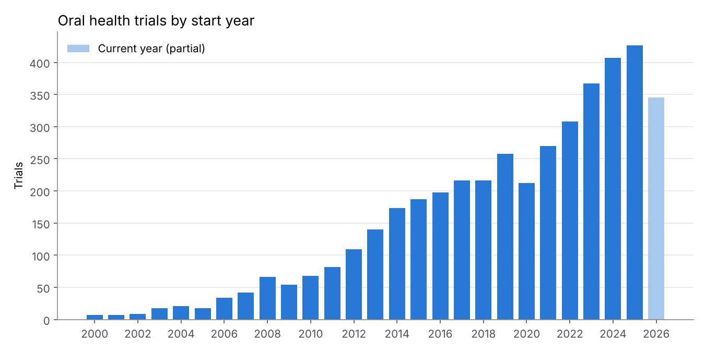
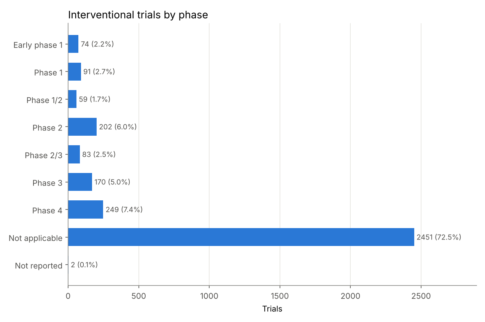
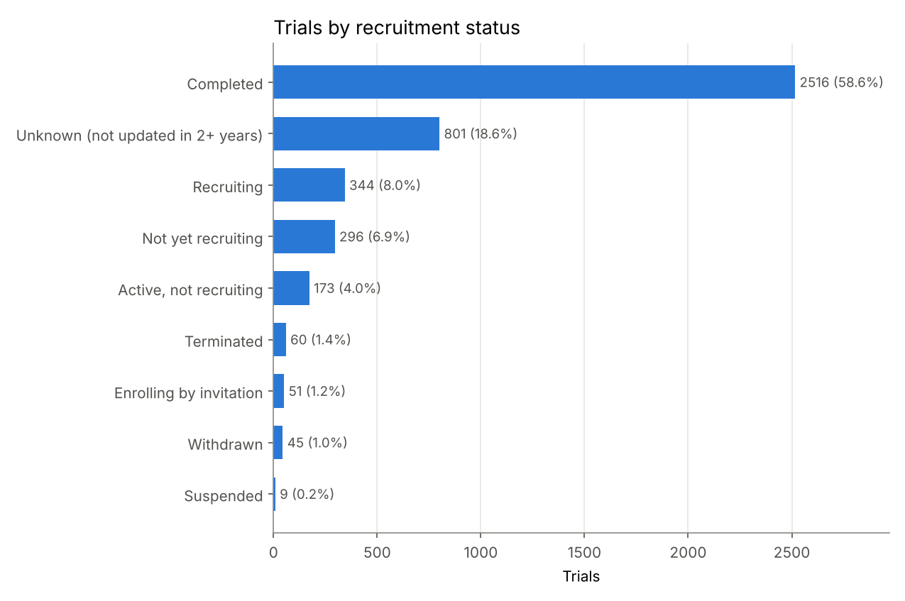
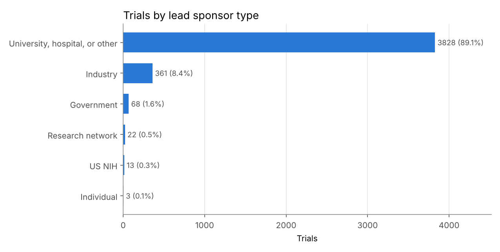
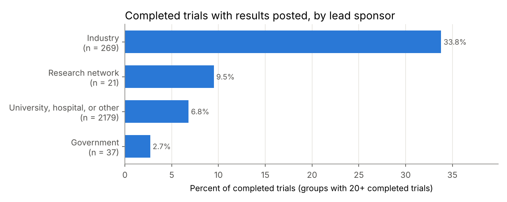

# Oral Health Clinical Trials: what is being studied, by whom, and how often results are shared

## The question

How many oral health trials are registered on ClinicalTrials.gov, what kind are they, who runs them, and what share of completed trials have posted their results?

## Why it matters

When I choose a mouthwash, a periodontal adjunct, or a caries-prevention protocol for a patient, I depend on trial evidence. If most completed trials never post results, the evidence a clinician can see is incomplete and may lean toward positive findings that were published. Knowing which kinds of sponsors share results, and how much of dental research is device and procedure work rather than drug work, helps me judge how much evidence to expect behind a treatment.

## Data source

- **ClinicalTrials.gov API, version 2**, run by the US National Library of Medicine: https://clinicaltrials.gov/data-api/api
- Endpoint: `https://clinicaltrials.gov/api/v2/studies`
- Search terms (condition field): periodontitis, dental caries, oral cancer, tooth loss, gingivitis.
- Data downloaded on October 17, 2026. The registry changes daily, so a new download gives slightly different numbers. `results/summary.md` is rewritten from your own run.

## How to run

You need Python 3.12 or newer (3.13 recommended; on a Mac, the pinned packages need macOS 14 Sonoma or newer) and an internet connection.

Download or clone this repository, open a terminal in the project folder, and run the commands below.

**Mac (Terminal):**

```bash
python3 -m venv .venv
source .venv/bin/activate
pip install -r requirements.txt
python src/01_download_trials.py
python src/02_clean_trials.py
python src/03_analyze_trials.py
python src/04_make_charts.py
pytest
```

**Windows (PowerShell):**

```powershell
py -m venv .venv
.venv\Scripts\Activate.ps1
pip install -r requirements.txt
python src/01_download_trials.py
python src/02_clean_trials.py
python src/03_analyze_trials.py
python src/04_make_charts.py
pytest
```

If PowerShell blocks the activate script, run `Set-ExecutionPolicy -Scope CurrentUser RemoteSigned` once and try again.

| Script | What it does |
|---|---|
| `src/01_download_trials.py` | Calls the API for each term, follows page tokens, retries on network errors, saves raw JSON to `data/raw/` |
| `src/02_clean_trials.py` | Flattens the nested JSON into one row per trial, removes duplicates, adds readable labels |
| `src/03_analyze_trials.py` | Builds the count tables and the results-posting tables, writes `results/summary.md` |
| `src/04_make_charts.py` | Draws five charts into `results/charts/` |

## Method

1. **Search.** Each term is searched in the condition field with `EXPANSION[Term]`. Without it, the API's default synonym expansion turned "oral cancer" into 4,552 studies, and inspecting their listed conditions showed breast cancer and lymphoma trials among them. With it, the search keeps spelling variants (for example "caries, dental") but stays on topic: 320 oral cancer studies. The download script repeats this comparison on every run and `results/summary.md` reports it.
2. **Combine.** The five searches returned 4,521 records. A trial can match more than one term (for example gingivitis and periodontitis), so duplicates were removed by NCT ID, leaving **4,295 unique trials**. The matched terms are kept in a column.
3. **Labels.** Phases were turned into readable labels. "Not applicable" is the registry's label for interventional trials with no drug phase, such as device, procedure, and behavioral studies. Sponsor classes were grouped: "OTHER" (universities, hospitals, nonprofits), "INDUSTRY", government (FED and OTHER_GOV), NIH, research networks, and individuals.
4. **Start year.** Taken from the first four characters of the start date, which is sometimes only a year and month.
5. **Results posting.** Among trials with status "Completed", the share where `hasResults` is true, meaning summary results were posted on ClinicalTrials.gov.

## Top 3 findings

All numbers come from the run on October 17, 2026. Full tables are in [results/summary.md](results/summary.md).

1. **Oral health trial registrations have grown steadily.** Trials starting each year rose from 7 in 2000 to 426 in 2025, the busiest complete year. Part of the early growth reflects registration becoming expected practice in the mid-2000s, so it is not only growth in research.
2. **Most dental trials are not drug trials.** Of 3,381 interventional trials, 2,451 (72.5%) have phase "Not applicable", which fits dentistry's focus on materials, devices, and procedures. Universities, hospitals, and similar institutions lead 3,828 of the 4,295 trials (89.1%); industry leads 361 (8.4%).
3. **Few completed trials share results on the registry.** Only 243 of 2,516 completed trials (9.7%) have results posted. Industry-led trials posted results far more often (91 of 269, 33.8%) than trials led by universities, hospitals, and other institutions (148 of 2,179, 6.8%). Another 801 trials (18.6%) have status "Unknown", meaning they passed their expected completion date without an update for over two years.

## Charts











## Limitations

- **Posting on the registry is not the same as publishing.** Many trials without posted results may still be published in journals. This project only measures results posted to ClinicalTrials.gov.
- **Not every trial is required to post results.** US law requires it mainly for certain drug and device trials with a US connection. Many dental trials are run outside the US or test procedures, so a low posting rate is partly expected. Trial locations were not analyzed here.
- **Search scope.** The search covers five conditions in the condition field only. A trial about, for example, implant failure that never lists these conditions is not included.
- **Self-reported registry data.** Status, dates, and sponsor class are entered by the trial teams and can be out of date.
- **Recent years are incomplete.** 2026 is a partial year, and trials completed recently have had little time to post results.

## Tests

`pytest` runs 42 tests on two small hand-made JSON files in `tests/fixtures/`. They cover the API retry logic (busy server, bad request, no internet), page tokens, empty API results, flattening missing fields, duplicate removal, phase and date parsing, every count and percent, and the clear error messages when an input file is missing.

Built in October 2026.

Developed with AI-assisted coding; analysis decisions and interpretation are my own.
